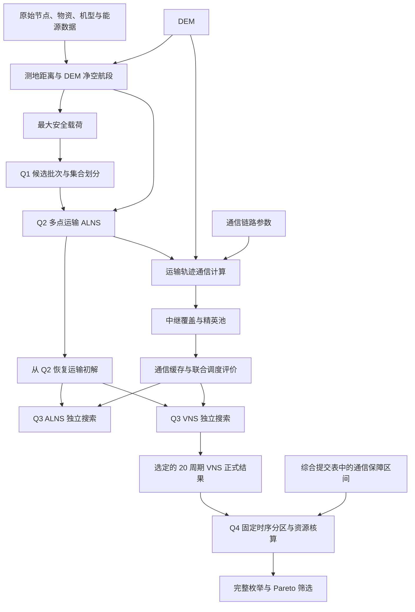

# 山区洪涝灾害下无人机运输与通信协同优化

**UAV Disaster Relief Optimization** · 运筹优化 · 资源约束调度 · 地理空间计算

面向山区洪涝灾害后的物资配送与通信保障，将地形航段计算、物资组批、多无人机调度、中继保障和任务分区连接为四个递进问题。实现包含集合划分 MILP、ALNS、VNS、无标签分区完整枚举与 Pareto 筛选，各方法承担不同层次的决策。

这是按文件白名单建立的**公开展示候选副本**，包含作者自有源码、原创技术文档和已核验的数值摘要。公开文件可用于模块导入、运行保护检查和原创小规模区间资源示例；不包含原始 Excel、DEM、正式结果工作簿、论文、图片或通信缓存，不能仅凭本仓库重现完整竞赛实验。作者已确认源码全部由本人编写，尚未选择通用复用许可证。

本次发布范围与新验证记录以 [Phase 6 验收报告](docs/phase6_report.md) 和 [文件白名单](docs/phase6_release_manifest.csv) 为准。Phase 2—5 文档保留历史溯源，其中提及的本地数据、目录、测试结果和旧哈希不代表这些材料存在于当前公开副本；大规模优化尚未重新运行。

## 目录

- [项目概述](#项目概述)
- [核心技术](#核心技术)
- [技术路线](#技术路线)
- [四个问题](#四个问题)
- [项目结构](#项目结构)
- [环境与快速开始](#环境与快速开始)
- [实验结果](#实验结果)
- [可复现性与已知限制](#可复现性与已知限制)
- [资料与公开范围](#资料与公开范围)

## 项目概述

山区地形同时影响飞行距离、净空高度、能源消耗和无线链路可见性。本项目先确定航段与安全载荷，再构造物资运输任务；在无人机、共享电池和配送时限约束下安排运输，并增加中继无人机维持通信；最后在既定联合调度时序下分析服务区分组与资源配置。

四个问题分别回答：**如何组批、如何调度、如何保障通信、如何配置分区资源**。目标函数与指标口径随问题变化，不能用一个加权目标概括全部模型，也不能将各阶段的时间指标直接横向比较。

## 核心技术

| 问题 | 数学模型与算法 | 工具及关键约束 | 输出与验证依据 |
|---|---|---|---|
| Q1 单点往返运输 | 可行批次枚举；集合划分 MILP；架次、能耗、累计作业时间的字典序优化 | PyProj、Rasterio、Gurobi；净空、质量、体积、电量，每箱恰好配送一次 | 航段、安全载荷、18 个批次；冻结工作簿和小规模模型构建检查 |
| Q2 多点运输调度 | ALNS；破坏修复、局部搜索、模拟退火接受 | Python、NumPy、Pandas；无人机、共享电池充电与占用、硬时限 | 20 个架次与资源时间表；归档 16 项可行性检查 |
| Q3 运输与通信协同 | 链路与地形遮挡计算；中继覆盖；联合评价；独立 ALNS / VNS 搜索 | 地理空间计算与通信几何缓存；运输、通信时间窗、设备资源 | 运输/中继联合时间表；归档数值覆盖检查 |
| Q4 分区与资源配置 | 任务关联图；无标签分区枚举；固定时序资源核算；Pareto 筛选 | NetworkX、Pandas；7 个服务区块、分区内资源占用及库存差额 | K=2、K=3 候选与代表方案；1008 项资源计数复核 |

主流程与绘图依赖见 [requirements.txt](requirements.txt)：NumPy、Pandas、Matplotlib、OpenPyXL、Rasterio、PyProj、GurobiPy、NetworkX、Affine、Pillow。OR-Tools 仅用于 [可选 CP-SAT 扩展](requirements-experiments.txt)，没有作为正式 Q2 求解器；源码没有 SciPy 导入。

## 技术路线



图中的依赖表示实现中的输入关系，不代表统一入口会自动执行整条流水线。**Q3 正式 VNS 从 Q2 运输解恢复初解，没有直接读取 ALNS 最优解继续优化。** 综合提交表的通信保障区间采用显式读取映射，未伪造缺失的历史模板。

## 四个问题

### Q1：单点往返运输与组批

用 WGS84 测地距离及 DEM 栅格采样计算航段，在 50 m 净空及机型载荷、电量限制下搜索安全载荷。DFS 枚举满足质量、体积、能源约束的物资批次，建立每箱物资恰好被选择一次的集合划分模型。Gurobi 按运输架次、总能耗、累计作业时间依次优化；能耗锁定使用实现中的数值容差。

输出航段表、安全载荷表和物资分批表，作为 Q2 的物理参数与初始解依据。正式批次由 19,525 个候选中选择；这里的时间是各批次作业时长之和。

### Q2：多点运输与共享资源调度

在 Q1 数据与批次基础上，联合决定物资分组、访问次序、无人机类型与任务优先顺序。调度评价器处理实体无人机和共享电池的占用、充电及配送时限；ALNS 使用 7 类破坏算子、4 类修复策略、局部搜索和模拟退火接受机制。

正式入口固定 **1000 次迭代、随机种子 20260927、权重 (0.55, 0.15, 0.15, 0.15)**，对应加权延误、最大完工时间、能耗和架次，目标以基准尺度归一化。输出运输航线、配送明细、无人机与电池时间表、收敛记录。1500 次版本属于扩展实验。

### Q3：连续通信保障的数值建模与联合搜索

根据链路预算和 DEM 遮挡识别直连受限区间，生成中继候选、覆盖关系及精英池；联合评价器安排运输与中继任务，核算无人机、电池和中继能源组件；目标分量包括加权延误、联合最大完工时间、运输及中继能耗、合计架次。缓存复用航段与候选中继的通信几何计算。

ALNS 与 VNS 是独立搜索路径。正式归档选用 **20 周期 VNS** 的干净结果，包含 20 条有效运输记录；VNS 包含航线内交换/反转、服务区箱组搬移/交换、机型与优先级调整等邻域。通信检查使用时间采样和边界细化，归档的零未覆盖时长是该数值精度下的结果，不能解释为任意连续时刻的解析证明。

### Q4：任务分区与资源配置

从 Q3 正式时序及综合提交表通信区间建立服务区关联和任务占用。对 7 个服务区块的 K=2、K=3 无标签分区完整枚举，在**固定任务时序**下分别核算运输无人机、电池、中继无人机与中继能源组件，按 8 类资源计数和 6 类工作量均衡指标筛选 Pareto 方案。

输出候选分区、资源明细、库存差额及代表方案 K2-032、K3-007。此阶段分析组织方式与资源需求，没有重新优化运输时序，也没有得出分区降低完工时间的结论。

模型、公式、算子和代码定位见 [方法文档](docs/methodology.md)。

## 项目结构

```text
UAV-Disaster-Relief-Optimization-public/
├── run.py                         # 41 个原有入口、运行清单与输出隔离
├── project_paths.py               # 输入映射、输出保护、可信缓存检查
├── requirements*.txt
├── src/problem1/ ... problem4/     # 四个问题的正式实现
├── experiments/                   # 基线、敏感性、种子及扩展算法
├── scripts/demo_public_intervals.py # 原创小规模区间资源示例
├── scripts/verify_archives.py      # 归档核验工具；需要另备授权输入
├── scripts/verify_public_release.py # 显式白名单及Git索引核验
├── data/raw/                      # 仅原始输入说明与文件清单
├── data/processed/                # 仅中间依赖说明与映射
├── results/runs/                  # 新运行输出；仅说明文件进入 Git
├── docs/                          # 方法、结果摘要、历史溯源与发布清单
└── tests/                         # 无数据测试及带明确跳过条件的归档测试
```

| 问题 | 正式运行入口（传给 `run.py` 的脚本名，不含 `.py`） |
|---|---|
| Q1 | `problem1_segment_preprocessing` → `problem1_max_safe_payload` → `problem1_batch_optimization` |
| Q2 | `problem2_final_run_and_visualization` |
| Q3 | `problem3_vns`；另保留独立的 `problem3_alns` 与通信预处理入口 |
| Q4 | `problem4_full_enumeration`；归档报告复核使用 `problem4_final_paper_results` |

入口清单可由 `run.py --list` 查询。版本参数见 [formal_versions.json](docs/formal_versions.json)，源码和输入映射见 [provenance.csv](docs/provenance.csv)、[dependencies.csv](docs/dependencies.csv)。

## 环境与快速开始

正式历史环境为 **Windows / Python 3.9.10**，直接依赖已固定版本。Phase 5 曾在不继承系统包的新虚拟环境安装主流程及可选依赖并通过 `pip check`；这属于历史验收。Phase 6 独立副本的实际命令、安装与测试结果另见 [本次验收报告](docs/phase6_report.md)。其他 Python 版本和操作系统尚未验证。

在项目根目录的 PowerShell 中执行以下命令；仅在 `.venv` 不存在时创建，不覆盖已有环境。

```powershell
python -m venv .venv
.\.venv\Scripts\python.exe -m pip install -r requirements.txt
# CP-SAT 扩展及全部 41 个模块导入检查需要可选依赖：
.\.venv\Scripts\python.exe -m pip install -r requirements-experiments.txt
.\.venv\Scripts\python.exe -m pip check
```

Q1 集合划分需要可用的 Gurobi 许可证。公开小示例和保护测试不启动 Gurobi 优化，也不需要正式算例。Phase 5 曾成功构建 18 变量、80 条约束的真实小模型，未调用完整优化；安装 `gurobipy` 不代表具备完整实验所需的许可。许可证文件和凭据不属于发布内容。

### A. 无私有数据的最小运行

```powershell
# 预期列出 41 个原有脚本入口，不启动实验。
.\.venv\Scripts\python.exe -B run.py --list
# 原创合成区间：直接调用现有 Q4 固定区间资源分配函数。
.\.venv\Scripts\python.exe -B scripts/demo_public_intervals.py
# 明确区分通过与因未分发材料而跳过的测试。
.\.venv\Scripts\python.exe -B -m unittest discover -s tests -v
# 文件集合、字节哈希与显式白名单核对
.\.venv\Scripts\python.exe -B scripts/verify_public_release.py
```

合成示例使用四个任务区间 `A:[0,4]`、`B:[1,3]`、`C:[3,5]`、`D:[5,7]`，预期所需资源数为 **2**；结束时刻等于下一任务开始时刻时允许复用。输出标记 `example=synthetic_public_demo`、`competition_result=false`，展示区间分配结果，不代表正式无人机运输方案、通信验证或竞赛实验结果。它不读取原始数据或通信缓存，也不修改正式算法；首次导入可能在独立`results/runs/`内创建Matplotlib字体缓存。

Phase 6在全新公开副本环境的实测为 **24项中15项通过、9项因缺少归档材料而跳过，0失败、0错误**，unittest耗时44.737 s。跳过项没有得到重新验证；安装全部声明依赖后，公开代码的模块导入、路径保护和合成区间核算应可独立检查。需要仅运行原有六项保护检查时使用：

```powershell
.\.venv\Scripts\python.exe -B -m unittest discover -s tests -p test_phase5_safety.py -v
```

### B. 授权材料下的归档复核与完整优化

[输入清单](data/raw/expected_inputs.csv)、[中间映射](data/processed/input_map.csv) 和 [运行说明](docs/running.md) 列出需要另行取得使用权限的文件。公开副本没有 `results/reference/` 工作簿和 `review_hold/` 缓存；归档核验工具、Q4 报告、绘图及完整优化命令不能在缺少这些输入时直接成功运行。

具备授权输入后，可以使用 `--raw-dir .\authorized-uav-data` 和 `--input-dir` 显式提供相应来源。路径仅为相对占位示例，命令行相对路径按启动目录解释。完整优化步骤见 [从原始输入构建中间依赖](docs/running.md#从原始输入构建中间依赖) 和 [完整复现计划](docs/phase5_full_reproduction.md)，**均未在本次重新执行**；Q2/Q3 与通信缓存重建须先评估计算预算。

统一入口不会自动串联各步骤或把新 Q1 输出传给 Q2。新结果写入 `results/runs/` 独立目录；任何本地补充的冻结 `results/reference/` 只用于读取。`run_manifest.json` 会记录实际输入和代码哈希，可能包含本地路径，不能加入公开 Git 清单。

## 实验结果

下表提取自正式冻结工作簿，保留 6 位小数显示；不是本次重新优化的结果。单元格定位、完整数值及哈希见 [结果口径与证据](docs/results.md) 和 [指标清单](docs/result_metrics.csv)。

| 指标 | Q1 单点组批 | Q2 多点运输 | Q3 运输与通信联合 |
|---|---:|---:|---:|
| 运输批次 / 架次 | 18 | 20 | 20 |
| 运输物资 | 80 箱 | 80 箱 | 80 箱 |
| 中继架次 | — | — | 3 |
| 能耗 / kWh | 59.128691 | 65.635532 | 68.771096 |
| 时间 / s | 32776.015749（累计作业） | 6955.476520（最大完工） | 6985.310068（联合最大完工） |
| 加权延误 / 加权秒 | — | 0 | 0 |
| 归档可行性检查 | `OPTIMAL` 求解状态 | 16 项 PASS | 13 项 PASS |

Q1 的累计时间是各批次时长之和；Q2/Q3 时间是并行调度的最大完工时间，不能据此计算跨问题的“提速比例”。Q3 能耗包含运输与中继两部分，联合完工时间取二者返航完成时间的最大值。

Q3 正式配置为 **8 架运输无人机、14 块电池、2 架中继无人机、3 套中继能源组件**；3 个中继架次不等于 3 架实体中继无人机。归档未覆盖通信时长为 **0 s**，检查采用 1 s 采样及对已检测转换边界的 0.01 s 细化，仍具有离散数值检查的限制。

| Q4 分区 | 枚举方案数 | Pareto 方案数 | 代表方案 | 运输无人机 / 电池 / 中继无人机 / 中继能源组件 | 重核算能耗 / kWh |
|---|---:|---:|---|---|---:|
| K=2 | 63 | 27 | K2-032 | 9 / 15 / 3 / 3 | 69.530804 |
| K=3 | 301 | 58 | K3-007 | 10 / 16 / 4 / 4 | 71.525243 |

两方案均沿用 **6985.310068 s** 的 Q3 时序。相对于现有库存，四类资源缺口分别为 `(1, 1, 1, 0)` 与 `(2, 2, 2, 0)`；Pareto 筛选在资源计数与平衡指标上进行，能耗在后续方案分析中核算。Q3 实际使用量不等于库存上限。

**图片展示待授权确认。** 已登记 15 张地形航迹、搜索收敛、调度甘特、通信覆盖及 Pareto 代表图，其中 12 张列为首页候选。现阶段不复制、嵌入或提供未经确认的图片下载；来源、论文图号和对应脚本见 [图片登记](docs/figures.md)。

## 可复现性与已知限制

| 验证层次 | 证据与边界 |
|---|---|
| Phase 6 公开副本 | 新环境安装和pip check通过；41模块导入、合成示例2资源、15测试通过/9归档项跳过；不继承历史成功结论 |
| 历史 Phase 5，带本地授权材料 | 原有 15 项及新增 6 项测试分别通过，无跳过；41 项归档检查和 1008 项资源计数一致，36 份正式结果哈希不变 |
| 历史 Phase 5，Q4 报告复核 | 25 项检查通过；10 份 LaTeX 表字节一致；619 个单元格在 `1e-9` 容差内一致，不声称新工作簿字节一致 |
| 静态检查 | 正式入口、参数与输入关系；不等于实际求解成功 |
| 尚未重新执行 | 大规模 ALNS/VNS、全量通信缓存重建、四问题端到端优化及跨平台验证 |
| 公开范围限制 | 工作簿、原始数据和缓存未分发，公开克隆无法独立复核正式数值；部分扩展缓存缺失，独立权重重新求解未完整完成 |

正式缓存覆盖 135/210 条有向航段，剩余航段按原算法按需计算。未知来源 pickle 不应加载，已有缓存也必须与实际输入指纹一致。

Q2 的固定尺度归一化、论文与代码的延误计入口径差别，Q3 ALNS 的固定基准与默认权重不一致，以及 NSGA-II、CP-SAT 扩展的可比性边界，均保留在 [已知问题](docs/known_issues.md) 与 [扩展实验说明](experiments/README.md)。本次文档整理没有借此修改算法，也没有将这些实验包装为已验证的性能提升。

## 资料与公开范围

- [方法与算法](docs/methodology.md)、[运行说明](docs/running.md)、[实验与扩展算法](experiments/README.md)。
- [正式结果口径](docs/results.md)、[图片来源](docs/figures.md)、[版本锁定](docs/formal_versions.json)。
- [Phase 3 工程报告](docs/phase3_report.md)、[Phase 4 文档与验收报告](docs/phase4_report.md)。
- [Phase 5 历史验收报告](docs/phase5_report.md)、[历史验收清单](docs/phase5_release_checklist.md)、[完整优化复现计划](docs/phase5_full_reproduction.md)。
- [Phase 6 发布报告](docs/phase6_report.md)、[当前白名单](docs/phase6_release_manifest.csv)、[发布检查清单](docs/phase6_github_release_checklist.md)。
- [公开授权与隐私审核](docs/publication_review.md)、[原始待审核清单](docs/review_required.csv)。

源码为作者本人实现，依据见 [作者确认](docs/phase5_authorization.json)。数据、DEM、竞赛题目及模板、最终论文、结果工作簿和图片仍分别审核。`.gitignore` 只是隔离措施，不构成授权证明；本地文件存在也不意味着可以公开。暂未添加 LICENSE，不宣称已授予通用开源复用许可；未上传 GitHub。
