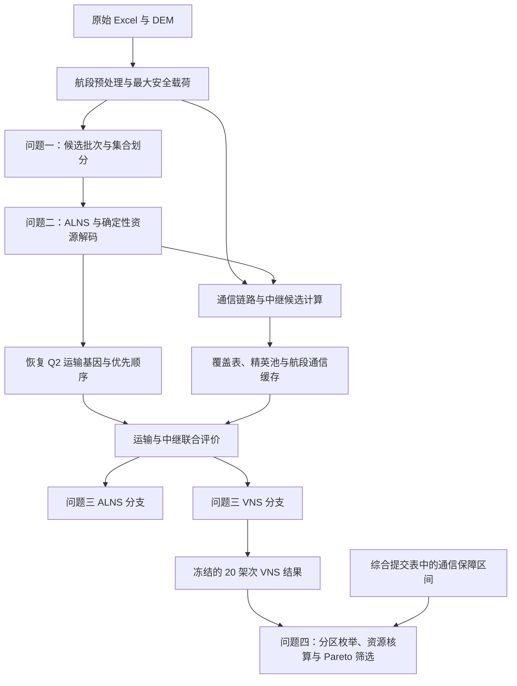
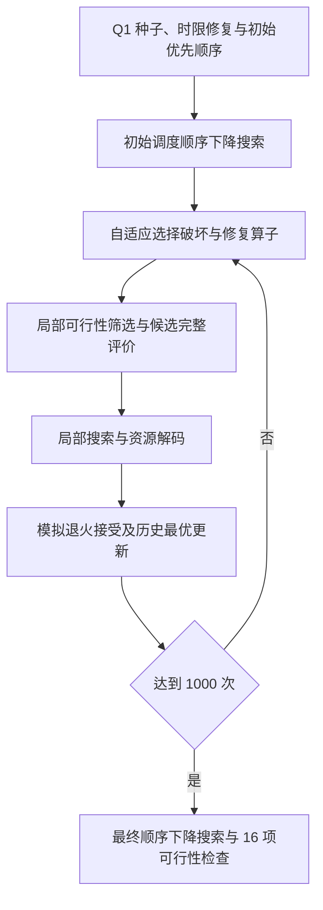

# 数学模型与算法实现

本文解释四个问题在当前代码中的实现及依赖关系。依据为已确认的最终论文、冻结工作簿和发布副本源码；论文身份及历史哈希见 [formal_versions.json](formal_versions.json)，原文件映射见 [provenance.csv](provenance.csv)。论文没有随仓库公开。本文件使用论文中的货箱、架次、服务区、机型、优先序列 $\sigma$ 和目标 $Z_k$、$Y_k$ 等术语；存在论文与实现差异时明确列出，不改写算法或归档结果。

## 1. 四个问题的关系

问题一确定地形条件下的单点运输能力和组批；问题二增加多点访问、实体无人机与共享电池调度；问题三在运输方案上加入通信中断识别、中继配置和联合评价；问题四固定问题三的任务及绝对时刻，分析资源不能跨组共享时的分区代价。

图中的 ALNS 与 VNS 共用评价、解码和缓存机制。正式 VNS 从 Q2 工作簿恢复运输基因，并不读取 ALNS 最优解作为初解；论文的“ALNS 全局搜索—VNS 局部强化”是方法框架描述，不能直接当作现有入口的串行文件依赖。

## 2. 问题一：单点往返与集合划分

### 2.1 航段、载荷与能源约束

[航段预处理](../src/problem1/problem1_segment_preprocessing.py)用 `pyproj.Geod(ellps="WGS84")` 计算节点间测地距离。DEM 地形取样则对经纬度平面中的直线栅格化，使用 `all_touched=True`，纳入线段穿过或触及的像元；这两个几何步骤不能混称为同一种距离算法。计划巡航海拔为沿线最高地形高程加 50 m，由端点作业高度推导有向爬升和下降高度，输出 16×16 航段矩阵。

[最大安全载荷](../src/problem1/problem1_max_safe_payload.py)沿用载荷相关的等效航程、水平飞行能耗与爬升附加能耗。单点往返的去程携带批次载荷，返程空载；模型没有另外加入下降能耗回收。对机型 $g$、服务区 $i$，最大安全载荷满足

$$
q_{gi}^{\max}=\max\left\{q\in[0,Q_g]:E_{gi}^{T}(q)\leq(1-\rho_g)E_g^{\mathrm{use}}\right\}.
$$

$Q_g$ 为机型额定载荷（kg），$\rho_g$ 为返航安全余量比例，$E_g^{\mathrm{use}}$ 为可用能源（kWh）。实现先检查满载、空载边界，再二分求解，并用 1001 个采样点检查往返能耗的单调非减性；该采样检查本身不是一般情形的解析证明。

### 2.2 可行候选与字典序优化

货箱不可拆分，同一批次只服务一个服务区。对服务区 $i$ 的货箱集合 $M_i$、机型集合 $G$，候选 $\omega=(i,B,g)$ 必须满足 $B\subseteq M_i$、$B\neq\varnothing$、批次质量不超过 $q_{gi}^{\max}$、批次体积不超过机型容积。DFS/回溯结合质量、体积上界剪枝枚举候选，归档算例共有 19525 个。

令 $x_\omega$ 表示是否采用候选，$y_{b\omega}$ 表示货箱 $b$ 是否包含在该候选中。集合划分约束为

$$
\sum_{\omega\in\Omega}y_{b\omega}x_\omega=1\quad(\forall b\in M),\qquad x_\omega\in\{0,1\}.
$$

质量、容积和往返能量可行性已在候选生成阶段处理。主模型因此是二元整数线性规划；非线性载荷能耗先计算成候选常量，并未直接交由 Gurobi 求解非线性模型。

按论文记号，$C(x)$、$E(x)$、$T(x)$ 分别为架次数、总运输能耗和累计作业时间：[集合划分代码](../src/problem1/problem1_batch_optimization.py)依次最小化三者，锁定第一阶段架次数后优化能耗，再保持能耗最优值的数值容差优化时间。第三阶段实际约束为 $E(x)\leq E^*+10^{-7}$ kWh，论文中的 $E(x)=E^*$ 是理想化写法。各阶段要求 Gurobi 返回 `OPTIMAL`；最优性仅针对已构造的候选模型及数值设置。

累计作业时间包括准备、逐箱装载、飞行、交接等架次时间之和，不考虑实体无人机并行执行。因此归档的 18 架次、80 箱、59.1286907835 kWh、32776.0157489162 s，不能与问题二、三的最大完工时间直接作快慢比较。

**输入与输出。** 输入为节点、货箱、机型 Excel 和 DEM；依次输出 `segment_preprocessing.xlsx`、`problem1_max_safe_payload.xlsx`、`problem1_batch_optimization.xlsx`。正式集合划分直接生成候选，不依赖 BFD 输出；BFD 和安全余量敏感性分析属于扩展实验。

## 3. 问题二：运输方案搜索与资源调度解码

### 3.1 解的表达及约束

运输解由每架次的货箱集合 $B_n$、访问顺序 $\pi_n$、机型 $g_n$，以及架次优先序列 $\sigma$ 构成。每架次从调度中心出发，访问一个或多个服务区，完成交付后返回。沿途交付使后续航段载荷减少，逐段计算载荷相关能耗。

[基础模型](../src/problem2/problem2_alns.py)与[资源解码](../src/problem2/problem2_alns_improved.py)分别检查货箱唯一配送、质量/体积上限、返航 SOC、首批物资硬时限及医疗物资硬时限。送达时间取服务区交接完成时刻，不能替换为到达时刻。

解码严格按 $\sigma$ 处理架次。对每个架次，从兼容机型的实体无人机与满电共享电池组合中，选择能够最早开始的组合；无人机返航后可再次使用，电池需按分段 SOC 充电公式恢复至满电后才能再次使用。同型 UAV 与电池是独立资源，不是永久绑定的一对。

### 3.2 四目标评价及论文口径差异

论文用 $Z_1,Z_2,Z_3,Z_4$ 表示加权配送延误、最大完工时间、运输总能耗和运输架次数。对应实现为

$$
Z_1=\sum_{j\in M}\gamma_j\max(0,T_j-d_j^{\mathrm{exp}}),\quad
Z_2=\max_n C_n,\quad
Z_3=\sum_n E_n,\quad
Z_4=|N_{\mathrm{flight}}|.
$$

$\gamma_j$ 为无量纲应急优先系数，所以 $Z_1$ 是加权秒数；$Z_2$ 单位为 s，$Z_3$ 为 kWh，$Z_4$ 为架次。论文的 $Z_1$ 求和集合写作排除首批保障货箱，代码实际遍历全部已配送货箱，同时另行检查首批硬时限。这里保留实际计算定义，不假定两种求和总是等价。

论文给出 min-max 归一化一般式；实际实现以固定参考尺度 $s_k$ 计算 $\bar Z_k=Z_k/s_k$，并采用 $F_{\mathrm{eva}}=\sum_{k=1}^{4}\lambda_k\bar Z_k$。$s_1$ 来自货箱优先系数与期望时间乘积之和，$s_2,s_3,s_4$ 来自 Q1 种子经原资源解码得到的指标，并设数值下界保护；它们在本次搜索中保持不变，不随候选解动态重算。不同参考尺度下的综合分数不能直接横向比较。

### 3.3 正式 ALNS 的实际流程

正式入口为 [problem2_final_run_and_visualization.py](../src/problem2/problem2_final_run_and_visualization.py)，调用改进 ALNS 与[修复评价加速实现](../src/problem2/problem2_alns_repair_optimized.py)。正式参数为 1000 次、种子 20260927、权重 `(0.55, 0.15, 0.15, 0.15)`、初温 0.03、降温系数 0.98、目标破坏比例 8%–20%。

| 环节 | 实际操作 |
|---|---|
| 7 类破坏 | 随机移除、最差贡献移除、相关性移除、整架次移除、迟延货箱移除、关键硬时限移除、资源拥堵移除 |
| 4 类修复 | 贪心插入、Regret-2、Regret-3、时限优先插入；必要时建立新架次 |
| 候选评价 | 快速代价排序后保留 Top-K=5，并额外保护最佳新架次、各可行机型、硬时限最早送达及匹配原组批的候选；因此完整评价次数不一定等于 5 |
| 局部搜索 | 架次优先序交换、移位、紧急架次前移、合并、拆分、机型变更、路径 2-opt |
| 评价缓存 | 用包含货箱、访问顺序、机型和架次顺序的签名复用完整评价 |
| 自适应选择 | 按动态算子权重选择；依据历史最优、当前改善、接受或拒绝计分，分段更新 |

Regret-2 比较次优与最优插入增量，Regret-3 累加第二、第三候选相对最优的增量差。候选接受依据完整资源解码的目标差 $\Delta F$：$\Delta F\leq0$ 时接受，否则以 $\exp(-\Delta F/\Theta)$ 接受；几何降温。局部搜索只有完整目标改善时才替换本轮破坏修复解，外层模拟退火负责接受部分较差候选。

**输入与输出。** 读取 Q1 航段和正式批次、原始需求与机型资源表；输出架次、逐箱送达、UAV/电池时序、目标值、算子统计和搜索日志。归档正式解含 20 个运输架次、零加权延误、最大完工时间 6955.47652001904 s、运输能耗 65.6355317188857 kWh。1500 次的 `experiments/problem2/problem2_alns_final.py` 是扩展包装器，不能与正式运行混用。

## 4. 问题三：运输与通信联合评价

### 4.1 链路可达及连续保障的计算含义

[通信模块](../src/problem3/problem3_communication.py)计算三维节点距离、自由空间传播损耗、DEM 遮挡附加损耗和双向链路门限。沿用论文公式

$$
L_{ij}^{\mathrm{path}}(t)=32.45+20\log_{10}f+20\log_{10}d_{ij}^{(3)}(t)+L_{\mathrm{obs}}b_{ij}(t).
$$

其中 $f$ 用 MHz，$d_{ij}^{(3)}$ 用 km，损耗单位 dB；双向门限取两个方向允许损耗的较小值。令 $A_{ij}(t)$ 为链路可达状态，论文中的连续保障要求为

$$
A_{uO}(t)+\sum_{r\in R(t)}A_{ur}(t)A_{rO}(t)\geq1.
$$

$O$ 在此表示固定网关 G01，不是运输调度中心 O01。运输爬升、巡航、下降和投送阶段需要直连或一跳中继形成的两跳通信；准备与装载阶段不要求通信。

[轨迹与中断识别](../src/problem3/problem3_core.py)依据分段轨迹检查直连状态，形成需要中继保障的时空需求。[中继覆盖](../src/problem3/problem3_relay.py)生成水平候选及 50–300 m 离地悬停高度，筛选可连网关的候选，预计算需求覆盖，使用加权贪心与局部细化形成候选部署。联合搜索还使用固定的 240 候选精英池及按需计算的航段通信几何缓存。

实现采用 1 s 确定性时间采样，检查阶段边界，对已检测到的状态变化进行 0.01 s 边界细化。归档“未覆盖时长为 0”表示该数值方法和容差下的检查结果，不构成任意连续时刻无中断的解析证明，不能排除采样网格间未检测到的短暂变化。

### 4.2 联合调度与四目标

[联合评价器](../src/problem3/problem3_alns.py)先解码运输，再生成通信需求、选择中继点并分配中继 UAV 和能源组件。中继计算包括准备、飞行、建链、服务、返航、周转以及能源恢复，检查资源时间冲突、续航和 SOC。运输机型、装载和时限约束继续复用问题二。

沿用论文的 $Y_k$：$Y_1$ 为运输加权延误，$Y_2$ 为运输与中继最晚返航时刻的最大值，$Y_3$ 为两者能耗之和，$Y_4$ 为两者架次数之和。固定尺度为

$$
(S_1,S_2,S_3,S_4)=(6321600,\ 6985.307588,\ 68.808141175,\ 23),\qquad
Y=\sum_{k=1}^{4}\lambda_k\frac{Y_k}{S_k}.
$$

代码及工作簿部分列仍命名为 `Z1`–`Z4`，在问题三上下文中对应上面的联合 $Y_k$；尤其能耗与架次数已经包含中继，不能按问题二的运输口径解读。

### 4.3 ALNS 分支与评价分层

问题三 ALNS 使用随机、相关性、最差贡献、整架次、连续航段和通信热点六类破坏；修复包括贪心、Regret-2、Regret-3、时限优先和通信感知插入。有限局部搜索尝试货箱移位、货箱交换、2-opt、机型变更，并包含优先序调整。搜索使用模拟退火、自适应算子权重、解评价缓存和航段几何缓存。

评价划分为三个层次：

| 层次 | 用途与限制 |
|---|---|
| LEVEL 0 | 低成本运输/通信代理排序，不执行完整轨迹通信审计 |
| LEVEL 1 | 资源解码与中继选择，用于搜索候选比较；`verify_exact=False` 时通信检查字段为占位通过，不能据此宣称完成通信验证 |
| LEVEL 2 | 调用标准通信复核，再检查资源和联合目标；仍属于上述采样、边界细化方法 |

默认 ALNS 配置为 500 次、种子 20260925、权重 `(0.55,0.15,0.15,0.15)`。但 `FORMAL_WARM_F` 由四个 0.25 权重计算，并参与退火初温及改善比较。这是已记录的口径问题，可能影响搜索轨迹；没有在工程或文档阶段修复，不能把跨权重分数差当作性能提升。

### 4.4 正式 VNS 分支

[VNS 入口](../src/problem3/problem3_vns.py)调用 `load_baseline_warm_start()`，从 Q2 的 `Sorties` 页按 `Schedule_Order` 恢复运输基因，再用联合评价器重新解码。它不加载 Q3 ALNS 最终运输方案。参数为 20 个循环、种子 20260925、权重 `(0.55,0.15,0.15,0.15)`，邻域改善阈值 $10^{-6}$。

| 邻域 | 代码中的精确定义 |
|---|---|
| N1 | 同一架次内交换两个服务区的访问位置 |
| N2 | 同一架次内反转一段连续访问序列，即 2-opt 型操作 |
| N3 | 将某架次内同一服务区的货箱整体移入另一架次，并调整访问顺序 |
| N4 | 不同架次之间交换两个服务区对应的货箱组及访问节点 |
| N5 | 保持货箱与路径，改变运输机型 |
| N6 | 调整架次优先序：相邻交换或单架次重定位 |

每个邻域先去重、检查运输可行性并按 LEVEL 0 代理值排序，仅前两个候选进入 LEVEL 1。发现优于 incumbent 超过阈值的解后重新从 N1 开始；一轮邻域下降结束后，从 N1/N3/N4/优先序重定位中选择小扰动作为下一轮搜索中心。论文对 N2/N3 的文字表述较简略，此处以函数实现解释，不能描述为穷尽全部候选的精确局部最优证明。

若最佳 LEVEL 1 解相对初解改善，才执行最终 LEVEL 2 标准审计；只有审计可行且联合目标确实改善时接受，否则保留初解。正式采用干净归档 `problem3_vns_20cycles.xlsx`：20 个运输架次、3 个中继架次，联合完工时间 6985.31006777659 s，总能耗 68.7710956385158 kWh。3 个中继架次不等于需要 3 架实体中继 UAV。

**输入与输出。** 输入包括 Q1 航段、Q2 正式结果、原始通信/中继参数、DEM、覆盖表、精英池与受信缓存。输出包括运输和中继时序、候选部署、通信检查、目标与邻域统计。缓存来源、135/210 条已有有向航段及未知 pickle 拒绝策略见 [运行说明](running.md)。独立权重重求解实验未完整完成，且其历史独立缓存仍缺失。

## 5. 问题四：固定时序下的任务分区与资源核算

### 5.1 不可拆分任务块与无标签枚举

[任务关联图](../src/problem4/problem4_service_zone_graph.py)以 15 个服务区为顶点：同一 Q3 运输架次访问的服务区必须同组，连通分量构成 7 个不可拆分任务块。分区只改变任务所属组，不改变货箱组批、机型、路径、交付与返航绝对时刻。

两组划分固定第一个任务块属于第一组以消除组标签对称；三组划分采用 restricted-growth string 递归枚举非空无标签分区。得到 K=2 的 63 个方案、K=3 的 301 个方案。这里“完整”指 7 个任务块和固定任务结构下的全部分区，不能扩大为自由重调度问题的全局求解。

### 5.2 区间资源核算

[资源核算](../src/problem4/problem4_group_scheduler.py)对每个实际出现的任务块子集缓存计算结果。运输 UAV 按型号分别统计准备开始至返航区间；共享电池统计准备开始至充满区间；中继 UAV 统计准备开始至返航后周转结束区间；中继能源组件统计准备开始至充满区间。按开始时刻排序，使用最小堆复用最早释放的资源，求固定区间系统所需最少实体资源数。

同一个中继任务在某组中无论保障几个运输架次都只计一次；如果其保障对象分属多个组，各相关组独立配置该中继任务及资源，并保留原时刻。跨组不能共享资源，因而可能增加配置与重复中继能耗。

通信区间通过综合提交表 `结果提交.xlsx` 的 `Q3_通信保障` 页明确读取。该映射已与冻结的 Q4 中继区间核对，不表示历史缺失文件“结果提交模板_问题三已填写.xlsx”已经恢复或与综合表字节相同。

### 5.3 Pareto 维度及代表方案

[完整枚举与筛选](../src/problem4/problem4_full_enumeration.py)使用 14 个最小化指标：A/B/C 型运输 UAV 三类、同型号共享电池三类、中继 UAV、中继能源组件共 8 类资源数量，以及货箱数、质量、体积、运输架次数、运输总时长、通信保障总时长的 6 项组间均衡指标。论文用相对极差定义均衡性：

$$
B_X=\frac{\max_k X_k-\min_k X_k}{\bar X},\qquad
\bar X=\frac{1}{K}\sum_{k=1}^{K}X_k.
$$

实现对均值接近零的指标返回 0。若某方案在全部 14 项上不劣且至少一项严格更优，则形成支配；比较容差为 $10^{-10}$。归档非支配集分别包含 27 个和 58 个方案。能耗、库存缺口和代表性分析参与后续报告与分层比较，不应被描述为原 Pareto 筛选的额外目标维度。

最终代表方案分析由 [selection_analysis](../src/problem4/problem4_selection_analysis.py) 和 [final_paper_results](../src/problem4/problem4_final_paper_results.py) 完成。K2-032 需 9 架运输 UAV、15 组共享电池、3 架中继 UAV、3 组能源组件；K3-007 分别需 10、16、4、4。两方案均有库存缺口；结构可行与库存可执行是两个判断。固定时序下不能声称分区降低了完工时间。

## 6. 证据与验证边界

| 结论 | 当前证据 |
|---|---|
| 模型与算法已实现 | 上述源码、最终论文与归档结果相互核对；差异已明确披露 |
| 基础工程检查 | Phase 3 的 15 项轻量测试、41 模块导入和 36 份冻结结果校验；具体记录见报告 |
| Q1 建模接口 | 用正式已选的 18 个候选构建 80 条覆盖约束；未调用完整候选优化 |
| Q3 缓存兼容 | 来源字节、相关输入哈希、签名及候选顺序核对通过；没有重建缓存或重新通信审计 |
| Q4 资源核算 | 126 个非空真子集 × 8 类资源，共 1008 项计数与归档一致 |
| 完整复现 | Q1 完整优化、Q2/Q3 大规模搜索及 Q4 全枚举未在工程阶段重跑；不能声称端到端复现成功 |

读取归档中的 `PASS` 是检查既有证据，只有重新执行相应验证函数才属于当前环境的再次核验。Phase 3 的实际命令、数值容差和未解决依赖见 [phase3_report.md](phase3_report.md)；正式参数与历史来源分别由 [formal_versions.json](formal_versions.json)、[provenance.csv](provenance.csv) 固定。公开数据、图表、论文及合作贡献的授权仍需单独审核，工程可读取不等于可以再分发。
